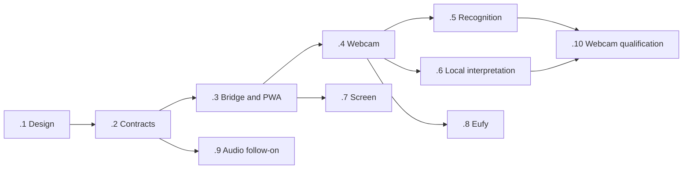

# System-1 sensory perception: implementation design

Status: proposed implementation baseline, 2026-10-25. Epic: v3-byw.
Design task: v3-byw.1. Implementation follows the operator's model handoff.
No sensor has been activated by this design work.

## 1. Goal and first useful result

Give the agent a cheap, current, uncertainty-aware sense of who has appeared
at a selected host webcam, controlled from the PWA, without continuously
calling a language model or creating a second thinking system.

First prove the whole path with synthetic observations. Then qualify a
webcam pilot: person enters, stays, leaves; optional explicitly enrolled
identity matching; one relevant observation reaches ordinary attention.
An unchanged scene produces no model calls or repeated interruptions.
The operator can stop capture remotely and see whether the source actually
acknowledged stopping. Recognition and remote inference start disabled.

The operator selected **host webcam first, then outdoor cameras**. Outdoor
devices are Eufy; exact models, HomeBase and firmware remain unknown.
Screen observation is a separate, pull-only milestone. Audio and expression
analysis are later extensions with separate controls.

## 2. Design lineage and current code

Read with the continued-experience agent, engineering specification and NFRs.
The original reference is
Z:/dev/paiProject/docs/pAI_System1_System2_Cognitive_Architecture_Design.md
(version 0.1). It is a behavior reference only; no v2 source is imported,
copied, wrapped or called.

Keep its layered perception, uncertainty, selective memory, local multimodal
interpretation and compact wake contract. Adapt its implementation to v3:

| Reference proposal | v3 decision |
| --- | --- |
| NATS/Redis event bus and additional state store | Bounded transport at the receptor boundary; existing kernel ledger and projection registry |
| Separate escalation state machine | Ordinary handlers and the existing scheduler; one thought mechanism |
| New memory service and pgvector | Existing memory/KG views and bounded recall |
| Independent context builder | Extend the existing present/stream slots |
| Every normalized event replayable forever | Raw frames stay ephemeral; selected transitions and consequential decisions are recorded |
| Audience-limited private thinking | Follow the newer private-thinking amendment: private thought remains private; egress and recipient disclosure remain enforced |

Code inspected at base revision 52a00a21bf:

- src/api/attention.lisp already implements layered mail/calendar appraisal,
  an attention stream and ordinary noticing thoughts. Its present slot is
  currently a bounded calendar view, not the general sensory present.
- src/mind/context.lisp owns the assembler and present/stream slots.
- src/kernel/scheduler.lisp owns handler admission and paid budgets.
- src/mind/decisions.lisp retains paid Decisions output before interpretation.
- src/mind/images.lisp stores images in the encrypted blob database, but its
  image table has no sensor retention/expiry fields. Do not send camera
  frames through the normal image-captioning loop in seeing.lisp.
- tools/beads-bridge.py demonstrates a narrow host capability boundary.
  tools/files-bridge.py and docs/behaviour/host-folders.md separate read and
  administration credentials. Neither is a capture service.
- Existing bridge HTTP/bearer behavior is precedent, not proof that the new
  transport satisfies ENC-2. Qualify the private encrypted transport.

The original spec 16.1 mixes non-ledger percept updates with projection-owned
state. Resolve that explicitly in v3-byw.2: only admitted compact transitions
update authoritative present rows via registered event reducers. Low-level
frames/tracks remain bounded receptor scratch, outside agent-derived state.
A heartbeat updates source freshness at a bounded cadence, not per frame.
Present is a view of rows with validity times; after expiry it reads unknown
or stale even if its expiry handler has not run. Do not introduce a second
projection writer or silently replay old sightings into present on restart.
If later experience requires non-durable projection inputs, that is a kernel
design amendment, not a worker writing projection tables.

## 3. Deployment and ownership

One physical source has one capture session and one low-level perception
owner. Detection/tracking/recognition must not be repeated for each agent.
The owner publishes scoped observations to approved subscribers; subscriber
agents apply their own relevance and have their own experience.

Prefer the worker as a small subprocess in the designated owner's container,
separate from the Lisp heap. It has no ledger access, no tools and no general
reasoning loop. It receives bounded jobs and allowances from the owner's
kernel. A network camera adapter can run there if supported and reachable.
A host webcam, microphone or desktop needs the host's device/session APIs.
Container device passthrough is an optional deployment profile, not assumed
on Docker Desktop. Keep the existing LM Studio endpoint shared; do not load
a 9B model into each container.

Suggested source separation:

- bridges/capture/: protocol, host grants/leases, status, platform adapters.
- bridges/capture/windows/: interactive-session webcam/screen adapter.
- services/perception/: bounded decode, detector/tracker, matching, audio adapters.
- src/perception/: event schemas, registered projections, handlers and views.
- src/api/perception.lisp and PWA components: operator controls and status.
- tests/perception/: synthetic contracts, replay scenarios and adapter tests.

Do not move existing bridges merely to tidy the tree. Keep each new module
under the repository size limits and its behavior spec beside it.

The capture authority issues a single source-owner lease with a monotonically
increasing epoch. It fences an old owner before assigning a new one. No
automatic failover in the first release. For direct network cameras, the
connector authority in the designated owner enforces the same protocol.
Each source records a separate notification owner. Subscribers may privately
notice, but only that owner may emit unsolicited sensor notifications.
Replies to explicit operator questions remain ordinary replies.

Approved peer delivery uses the existing authenticated fleet route and
disclosure checks, with a typed percept payload and common observation id.
Sharing a source does not grant access to frames, templates or all identities.
No broadcast of household data through the public/guest forum.

## 4. PWA control and capture authority

Expose a source card showing device/source, capture owner, subscribers,
desired state, acknowledged state, last sample, last observation, expiry,
recognition state, inference route, resource use and reason for degradation.
Agents get the same bounded status view, including operator-disabled.

Controls are independent: camera capture, screen capture, microphone,
transcription, recognition, media retention and remote inference.
Enable/enrollment/grant changes require existing operator authentication and
step-up. An authenticated stop must remain easy during a running session;
it does not wait for a model or a fresh enable workflow.
A global stop fans out to every source authority and subscriber.

Proposed versioned API under /v1/perception:

- GET sources: bounded registry/status view; pagination if needed.
- POST sources/{id}/session: selected source, duration, mode and request id.
- DELETE sources/{id}/session: revoke and return acknowledgement state.
- POST stop: revoke all active sessions; per-source acknowledgement.
- POST sources/{id}/snapshot: one bounded capture within an existing grant.
- POST profiles/enroll, profiles/{id}/revoke and observations/{id}/correct:
  explicit operator operations, separate from capture permission.

The bridge protocol offers only inventory, status, leases, bounded samples
and revocation. No shell, arbitrary URL fetch, desktop control or filesystem
access. Server-owned source IDs map to configured devices. Separate scoped
administration and sampling credentials; authenticate machine principals.
Use TLS/private encrypted transport and destination-bound credentials.
Secrets, endpoint addresses and device identifiers stay out of source fixtures.

Session defaults proposed for calibration: 30 minutes webcam; one requested
snapshot for screen, with a 10-minute authorization window. Host indicator
persists independently of the PWA tab. Browser disappearance is not proof of
a native session ending; the session has its own expiry. An unattended door
watch requires an explicit renewable policy, not an accidental infinite
webcam session. PWA displays the applicable expiry.

Stopping increments the epoch, closes capture handles, purges queued raw
samples and rejects old-epoch deliveries at ingress, interpretation and
publication. Mark derived present rows disabled/unknown and cancel pending
sensor wakes that are no longer valid. Already-paid results remain recorded
with revoked/stale disposition; never reuse them as current evidence.
Check authorization again immediately before egress. Revocation cannot
recall data already sent to an enabled remote provider.

A disconnected authority cannot truthfully acknowledge stop. Display
"stop requested; unconfirmed" until acknowledgement or lease expiry.
Sampling leases expire within 10 seconds without renewal; use monotonic
time at the authority. Test maximum capture-stop latency under partition.
Do not give the PWA a false green "off" while a host may still be capturing.

Browser screen sharing is a different receptor: getDisplayMedia requires a
local user gesture and a selection prompt; permission cannot simply be
persisted. A remote phone cannot start screen sharing on another computer.
The native bridge can service a previously enrolled host capability, subject
to local OS permissions/session availability. Locked, suspended or absent
desktop sessions report unavailable; never bypass a secure desktop.

## 5. Cheap perception ladder

| Stage | Camera | Screen | Audio, later |
| --- | --- | --- | --- |
| L0 | Sample/motion gate plus periodic presence refresh | Explicit pull; selected window metadata/change features | Sound energy/VAD |
| L1 | Person detector, tracker, optional face matcher | Accessibility first, selective local OCR | Sound classes, gated STT |
| L2 | Local multimodal model for relevant ambiguity | Local interpretation of selected crop/text | Ambiguous utterance/context |
| Appraisal | Existing attention, optional typed decision | Same mechanism | Same mechanism |
| System-2 | Ordinary thought with bounded evidence | Ordinary thought | Ordinary thought |

Motion alone is insufficient: a person can remain still. Periodic cheap
presence refresh maintains tracks; expiry produces uncertainty, not a false
departure. Track identifiers are scoped to source and epoch. No cross-camera
person re-identification in the first release.

YOLO detects classes such as person, not household identities. Benchmark a
small detector with tracking separately from face detection/alignment and
embedding comparison. Candidate implementations: YOLOX with ONNX Runtime,
or a small Ultralytics detector with an explicitly reviewed artifact license.
Choose based on this host's p95 latency, RSS/VRAM and missed-arrival rate,
not benchmark marketing. Record code and model-weight licenses separately.

The local model receives at most two selected crops/keyframes and a short
structured question. Never poll the VLM on a fixed camera frame rate.
Local interpretation returns hypotheses with evidence ids, not tool calls,
instructions or grants. Invalid output degrades enrichment only.
Verify the installed Qwen variant actually supports images and the chosen
structured-output API. Parameter count is not a capability guarantee.

Use existing llm.profiles/routes for perception interpretation and existing
Decisions transport for optional appraisal. No fallback from local-only to
cloud. Remote text appraisal is also disclosure: redact/minimize and apply
the source's policy, even if no image is attached. Capture permission does
not grant remote inference. Keep paid receipts and accounting intact.

## 6. Recognition, profiles and audience

Enrollment links an explicit person profile to consented reference samples.
The operator administers household profiles; record the applicable consent
or guardian authorization, allowed sources, intended recipients, expiry and
deletion policy. Do not infer names, age or relationships from appearance,
auto-enroll visitors, or scrape family photos.

Keep templates and reference media in private encrypted storage, never in
events, code, forum posts or ordinary model prompts. Load a bounded profile
working set, e.g. at most 32 profiles with 5 templates each in the pilot.
Store model/checksum/embedding version; incompatible models require explicit
re-enrollment or an approved migration, never silent template conversion.

A match is a hypothesis: candidate profile, similarity score, quality,
threshold version and basis. Similarity is not calibrated probability.
Use an open-set rejection threshold plus top-two margin, multiple good
frames, and an explicit unknown result. Bad lighting, occlusion, multiple
people, children changing appearance, and related-looking people must be in
private qualification. Never force the nearest match to be a known person.
A photo/replay may fool recognition; it grants no authentication or access.

Correction appends a small event naming the superseded observation and the
operator-confirmed correction. Present and recall render the corrected state,
not two simultaneous identities. Do not silently train on a correction;
template updates are explicit, versioned and reversible. Correction history
can inform calibration. A later thought must be able to see that a previous
attribution was corrected.

Presence never grants authority or widens disclosure. Sensor evidence may
restrict a shared-room output audience, but cannot establish that nobody
else can hear, nor authenticate someone making a request. Stale, partial or
missing coverage defaults to unknown nearby for shared physical outputs.
A private authenticated PWA conversation is not automatically a room speaker.
Observed speech and screen text remain untrusted source content.

## 7. Contract and lifecycle

Transport observation schema v1 (synthetic example):

    {
      "source_id": "webcam-a", "epoch": 7, "sequence": 42,
      "observation_id": "obs-demo-42",
      "observed_at": "2026-10-25T12:00:00Z",
      "expires_at": "2026-10-25T12:00:10Z",
      "kind": "person.entered", "track_id": "7:3",
      "recognition": {"state": "unknown", "candidate": null},
      "detector": {"model_id": "fixture-v1", "score": 0.91},
      "evidence_ref": null, "sensitivity": "operator-only"
    }

Receiver derives received_at, authenticated source/owner, allowed sensitivity
and grants. Caller-supplied principal fields never establish authority.
Validate schema, byte count, finite scores, timestamps, sequence, epoch and
source grant. Source clocks cannot extend validity beyond the receiver's
maximum TTL. Dedupe on source/epoch/sequence and retain bounded high-water
state; this is transport ordering, not an independent ledger cursor.

Register proposed event families before use:

- receptor.state.changed: source, epoch, acknowledged state and reason.
- percept.observed: admitted transition, <=2 KB, evidence refs and uncertainty.
- percept.corrected: target id, replacement hypothesis and provenance.
- perception.appraised: feature scores, disposition and model receipt refs.
- perception.profile.changed: opaque profile id/version and operation only.

Use the existing registry for source status, current situation, correction
links and appraisal receipts. Every query has a key/type predicate and LIMIT.
One view composes calendar and sensory facets in the existing present slot.
Bound the sensory portion initially to 300 tokens; expose more detail by
inspection, not by growing every prompt. The stream gives a small digest
of noticed/set-aside transitions without making a frame backlog.

Transient samples expire in scratch. Promoted observations have validity
independent of retention: an old event may remain historical evidence but
cannot remain current presence. Existing retention/consolidation rules govern
ledger removal; do not claim a row TTL physically erases an append-only
event. Keep sensor observation detail out of durable knowledge formation
unless explicitly promoted. Register retention/forget support and test
correction/deletion propagation through projections, recall and backups.

Store retained media only in the encrypted blobs store with expiry and byte
quota. Initial pilot uses no continuous recording and no pre-roll.
Decode buffers live in bounded RAM; disable file-backed decoder caches and
content logs. Evidence can be unavailable/expired without erasing the fact
that an observation occurred. Never preserve a frame solely to make an
otherwise cheap debug trace convenient.

## 8. Budgets and failures

These are proposed qualification limits, not measured performance claims.
Expose them as settings and central scheduler allowances, not per-module
retry loops or private spending counters.

| Resource | Pilot starting limit/target |
| --- | --- |
| Active source | One webcam owner; one detector invocation at a time |
| Camera sampling | 1 fps baseline, up to 5 fps during change |
| Worker raw queue | 2 frames, <=8 MiB; replace stale unprocessed frames |
| Structured pending work | <=64 items/source and <=128 KiB |
| Worker RSS | <=384 MiB initial target, measured separately from agent RSS |
| Lisp scratch | <=8 MiB; keep original agent memory gates |
| Local VLM | 1 in flight fleet-wide for this pilot, <=2/min and <=60/day |
| VLM input/output | <=2 images; <=1,500 text input / 256 output tokens |
| VLM deadline | 3 seconds; no hidden cloud fallback |
| Remote sensory appraisal | Disabled; proposed opt-in ceiling USD 0.05/day within existing budget |
| Presence-to-observation | p95 <=2 seconds on qualified webcam hardware |
| Stop acknowledgement | p95 <=2 seconds connected; <=10 seconds lease expiry disconnected |
| Retained raw media | Zero by default; encrypted evidence TTL/quota only after explicit enable |

An 8-hour naive 1-fps VLM watch would make 28,800 calls. The proposed
event-triggered ceiling is 60/day across the pilot, not 60 per subscriber.
The ceiling is not a target. Count detector work, GPU-seconds, queue age,
VLM calls, paid spend, promotions and operator interruptions independently.

When loaded, first reduce enrichment/resolution and coalesce unchanged work.
Replace stale unprocessed frames; preserve compact arrival/loss transitions
where possible and record overflow/gaps. Never imply perfect coverage while
dropping input. Already-paid cognition is retained, including invalid or
late responses, under the existing scheduler failure policy.
A failed detector leaves camera availability known but recognition degraded.
A failed VLM leaves detector observations usable. A failed source expires
presence. System-2 being offline does not stop L0/L1 within leases, but also
does not grow a backlog of raw media.

Source loss is one state change, not one thought per failed poll.
Persistent loss may become salient under ordinary attention. Recovery is
normally quiet. Operator stop has its own reason, distinct from hardware loss.

## 9. Screen, Eufy and audio follow-ons

**Screen.** First support explicit snapshots of a selected window/region.
Prefer structured accessibility metadata where separately granted. No
clipboard, broad terminal history, browser credential storage or input
control. Mask configured regions and protected controls before pixels or
text leave the host; pattern detection alone cannot promise secret removal.
If masking is unreliable, withhold that region. Local host/container
processing is permitted only by that source's grant; cloud screen input stays
off. Continuous change observation is a later explicit mode, not implicit in
a snapshot grant. YOLO is not the default screen-understanding model.

**Eufy.** Inventory exact camera model, firmware, HomeBase, NAS/RTSP capability,
event-only versus continuous availability, and permitted network path.
Eufy documents NAS setup for supported devices; this does not establish
support on every camera or an authenticated universal API.
Do not configure a guessed RTSP URL or assume ONVIF.
If local streaming is unsupported, document the blocked adapter and choose
an authorized vendor integration separately. Sleeping cameras, stream startup
delay and dropped connections must not become "nobody is at the door."
If a device only supports unencrypted RTSP, it fails the default ENC-2 gate;
design a local gateway/protected device network and explicitly resolve the
remaining unencrypted hop before deployment.

**Audio.** Separate ambient sound classification from recording speech.
Candidate first stack: Silero VAD followed by local faster-whisper/whisper.cpp
evaluation, with STT only on voiced segments. Doorbell/sound detection needs
a sound-event classifier, not merely VAD. Add diarization and enrolled
speaker matching later; a speaker label is not a verified person.
TV, playback, overlap and uncertain addressee never execute instructions.
Do not start a microphone merely because webcam capture was enabled.

**Expressions.** Defer until arrival/identity is useful and calibrated.
Observable cues such as a smile can be optional uncertain short-lived
observations; do not treat facial expression as a fact about mood, intent,
health or character, or automatically write it into the person's profile.

## 10. Acceptance and rollout

Synthetic fixtures contain invented IDs, generated images/metadata and no
real household media. Private consented hardware evaluation stays outside
source control. Synthetic contract tests alone cannot qualify face accuracy.

1. Duplicate/out-of-order/old-epoch observations yield one current state.
2. Enter/stay/leave and stationary-person scenes produce stable presence,
   no repeated VLM calls, and one bounded attention decision.
3. Unknown/low-quality/lookalike matches remain uncertain; no recognition
   result upgrades principal authority or disclosure permissions.
4. Correction supersedes the current identity and is visible to recall.
5. Stop during capture, inference, queued wake and send invalidates stale work;
   paid receipts remain available. Partition tests show unconfirmed then expired.
6. Source loss and disabled state are visible to PWA and agent inspection;
   reopening never resurrects a historical presence.
7. Three subscribers produce one detector pass and at most one unsolicited
   notification for the same observation; unauthorized subscribers get no data.
8. Local provider failure does not leak to a remote fallback. Paid Decisions
   responses are retained once, including parse failures and late arrivals.
9. No raw media in events, traces, crash logs, temp files or automatic image
   captions. Retention, deletion and bounded storage are exercised.
10. CPU/GPU pressure and event floods preserve chat responsiveness, expose
    coverage gaps and remain within measured memory and queue bounds.
11. Screen tests include protected controls, denied windows, session lock,
    malicious on-screen instructions and expired selection.
12. Eufy tests distinguish no visitor from no available stream; audio tests
    distinguish silence from missing coverage and replay from authority.

Run each Lisp suite in a fresh process. Qualify projection/schema migration
on a backed-up copy; no live projection replay, identity changes or
re-derivation of paid state. On deployment record running revision, measured
budgets and each agent's inside status check. Roll back code/config with
captured experience retained. Sensors remain off after installation until
the operator activates the selected source.

Rollout: synthetic slice -> webcam detector shadow -> private enrollment and
recognition shadow -> operator-enabled noticing -> Eufy door qualification.
Screen and audio have their own acceptance/activation gates. No remote
publication under this local-only plan.

## 11. Beadwork handoff

| Bead | Work | Depends on |
| --- | --- | --- |
| v3-byw.1 | This design and consultation | — |
| v3-byw.2 | Contracts, present/attention and synthetic slice | .1 |
| v3-byw.3 | Separated capture bridge and PWA controls | .2 |
| v3-byw.4 | Single-owner webcam worker and model benchmarks | .3 |
| v3-byw.5 | Enrollment, recognition and corrections | .4 |
| v3-byw.6 | Local enrichment and optional Decisions | .4 |
| v3-byw.7 | Pull-only host screen | .3 |
| v3-byw.8 | Eufy capability qualification and door receptor | .4 |
| v3-byw.9 | Optional audio/expression follow-on | .2 |
| v3-byw.10 | Webcam qualification and staged rollout | .5, .6 |

The graph represents dependencies, not permission to enable all modalities.
Start implementation with v3-byw.2 after the operator's model handoff.
Finish one ticket in its own worktree, commit and close with evidence.
No bw sync, remote, push or publication.

## 12. Review, decisions and qualification gaps

Two crew members responded to the initial proposal. Their convergent feedback
is incorporated: compact inspectable state, explicit uncertainty/expiry,
one shared low-level perception result, one notification owner, and visible
corrections. One review opposed per-agent duplicate workers; accepted.
Session-scoped consent and pull-only screen access are adopted defaults.
"Screen never leaves host" is narrowed to no cloud by default, with explicit
permission needed for local-container processing; full agreement on that
distinction has not been obtained. Unattended door policy also remains an
operator decision. No claim of full crew consensus.

Guest consultation exposed an identity failure: the available guest token
authenticated another coding agent. Identifying the author in prose did not
repair that mismatch. Use stopped; v3-62e tracks separate coding-agent guest
credentials and client identity verification. Further consultation requires
proper Codex enrollment. Preserve original forum provenance; do not rewrite
the authenticated author to conceal the error.

Remaining deployment inputs: exact Qwen model and quantization, LM Studio
version, GPU/VRAM and concurrent load, selected webcam device/driver, Eufy
models/HomeBase/firmware and local stream support. Inventory was requested
on the forum before credential use stopped. No hardware performance or
recognition accuracy has been measured. Docker inventory was not available
under the initial sandbox; private launch configuration identifies three
separate containers, but this design does not claim live health validation.

This change is documentation/backlog only. No Lisp or hardware test execution
is claimed. Before implementation freeze, resolve the v3-byw.2 lifecycle
contract, current sender dedupe seam and centrally enforced local-compute
allowances in code; the current paid scheduler is not proof those limits
already exist.

## 13. External references checked 2026-10-25

- LM Studio image input:
  https://lmstudio.ai/docs/python/llm-prediction/image-input
- LM Studio structured JSON:
  https://lmstudio.ai/docs/developer/openai-compat/structured-output
- OpenRouter typed Decisions and calibration:
  https://openrouter.ai/blog/tutorials/how-to-use-jev/
- YOLOX implementation and license:
  https://github.com/Megvii-BaseDetection/YOLOX
- Ultralytics tracking and licensing:
  https://docs.ultralytics.com/modes/track/
  https://www.ultralytics.com/license
- InsightFace code versus pretrained-weight terms:
  https://github.com/deepinsight/insightface
- Browser capture requirements:
  https://www.w3.org/TR/screen-capture/
- Windows capture/session UI:
  https://learn.microsoft.com/en-us/windows/apps/develop/media-authoring-processing/screen-capture
- Local audio candidates:
  https://github.com/snakers4/silero-vad
  https://github.com/SYSTRAN/faster-whisper
- Eufy NAS/RTSP setup for supported devices:
  https://service.eufy.com/ca/article-description/Using-NAS-Storage-Step-by-Step

These validate capability categories, not the installed system. Pin and verify
specific artifacts during benchmarking. In particular, InsightFace's MIT code
license does not grant unrestricted use of its public pretrained weights.
